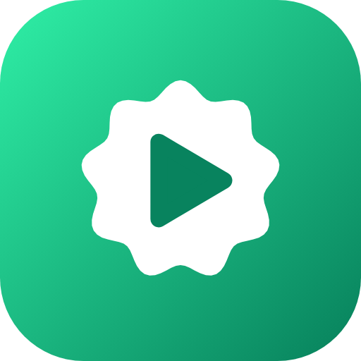
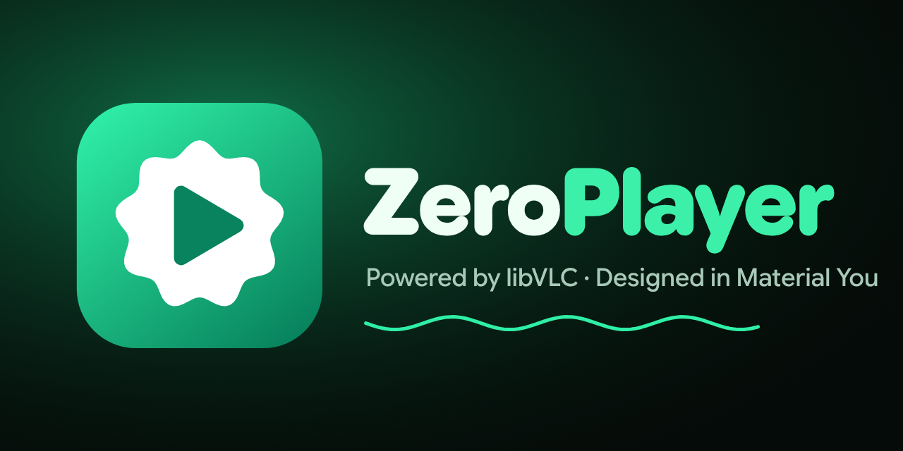
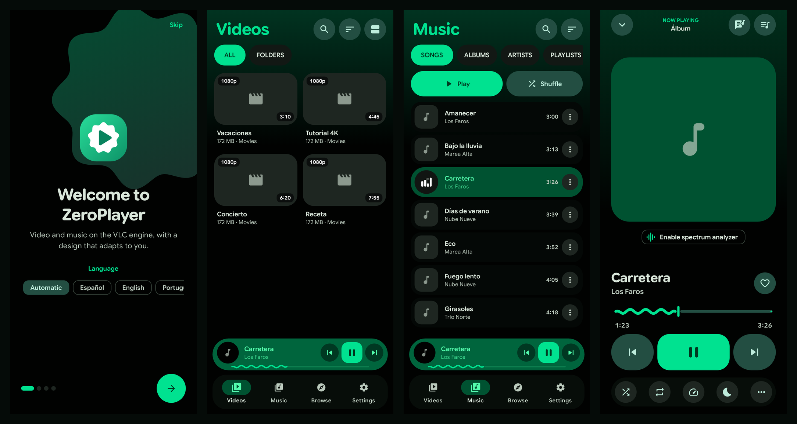

  
  
  

# ZeroPlayer

**Website:** https://Xito-Development.github.io/ZeroPlayer/

A video and music player for Android and Windows built on the **libVLC** engine, with a fresh
**Material You** interface: wallpaper-based colours, a wavy progress bar,
shape-morphing buttons and smooth transitions. Design inspired by [PixelPlayer](https://github.com/PixelPlayerHQ/PixelPlayer).

## Features

**Video**
- Grid or list library, folders, sorting and "continue watching".
- Gestures: double tap to seek, swipe for brightness, volume and seeking (or to change video), hold to speed up.
- Skip intro button and "next episode" countdown (from file chapters or marked once per series).
- Audio tracks, subtitles (also from a file), delays, speed, aspect ratio, screen lock, chapters, A-B repeat, audio boost, equalizer.
- Picture-in-picture (system or in-app floating window), or keep listening with the screen off.
- Recognises the song playing in a video and opens it in your music app.
- Offline voice commands with a wake word ("Zero, pause" / "Cero, pausa") in 6 languages.

**Music**
- Songs, albums, artists, folders, favourites, playlists and history.
- Synced lyrics fetched automatically (LRCLIB or a local `.lrc` file), with on-device translation.
- Crossfade between songs, real-time spectrum analyzer and waveform.
- Expanding player tinted with the album cover colours.
- Reorderable queue, shuffle, repeat, sleep timer, equalizer.
- Background playback with lock-screen controls. Remembers your last queue.

**Internet**
- YouTube and 1000+ sites through yt-dlp (updates itself daily): play right away or download the video or the MP3.
- Share a link with ZeroPlayer from YouTube or your browser.
- SponsorBlock: skips sponsors, intros and reminders automatically. Also skips silent parts in songs.
- Cast to Chromecast and compatible devices.

**Browse**
- Open any file or network stream (HTTP, HLS, RTSP…).
- Phone, SD card and USB folder browser.
- Local network: UPnP/DLNA servers and SMB, FTP, SFTP and NFS shares.

**Languages**: English, Español, Português, Français, Deutsch, Italiano.

## Windows

A Mac-style desktop version with the same engine: library, video and music player, YouTube links,
drag and drop, keyboard shortcuts (Space, ←/→, ↑/↓, F, M, Esc), a custom installer and automatic updates.

## Install

- **Android:** download `ZeroPlayer-arm64-v8a.apk` from **[Releases](../../releases/latest)** (or `armeabi-v7a` for phones older than 2017) and open it on your phone.
- **Windows:** download `ZeroPlayer-Setup.exe`. It installs without admin rights.

Both apps check this page for new versions and update themselves.

## Credits

- Playback engine: [libVLC](https://www.videolan.org/vlc/libvlc.html) by VideoLAN (LGPL 2.1). ZeroPlayer is not an official VideoLAN or VLC product.
- Internet links: [yt-dlp](https://github.com/yt-dlp/yt-dlp) (Unlicense). Segments: [SponsorBlock](https://sponsor.ajay.app). Lyrics: [LRCLIB](https://lrclib.net).
- Windows version: [vlcj](https://github.com/caprica/vlcj) (GPL 3) and Compose Multiplatform.
- Design inspired by [PixelPlayer](https://github.com/PixelPlayerHQ/PixelPlayer) by theovilardo.
- Typeface: Google Sans Flex (SIL Open Font License 1.1).

